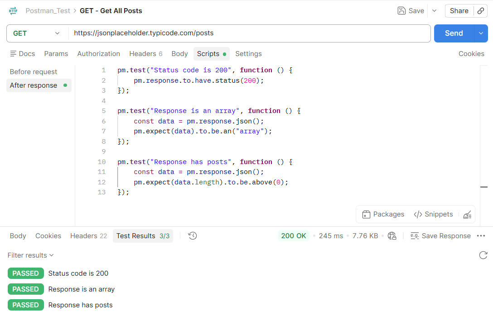
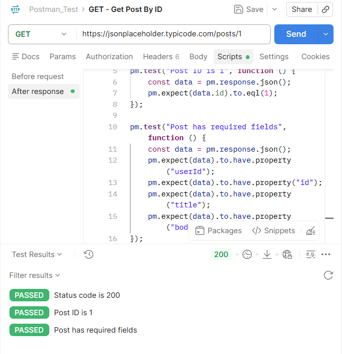
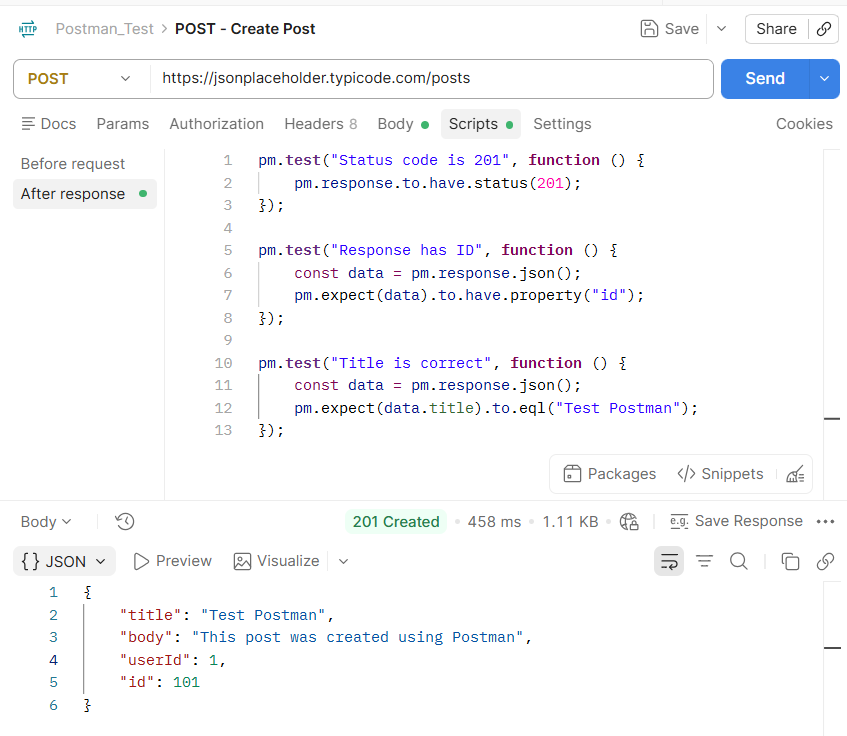
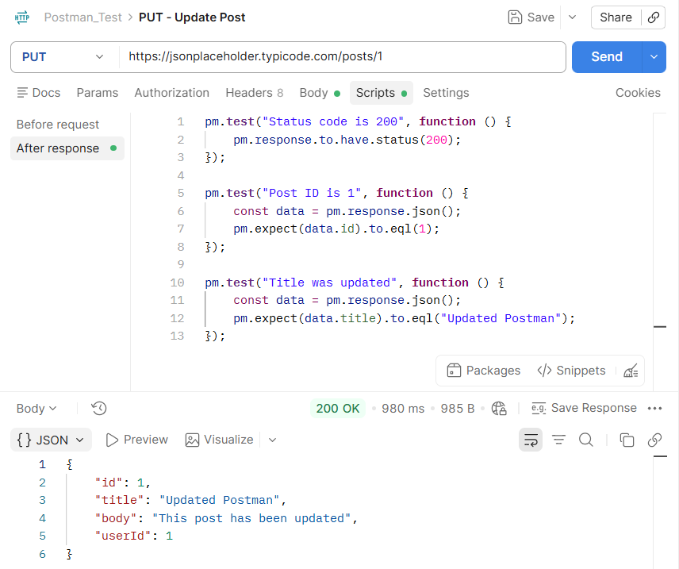
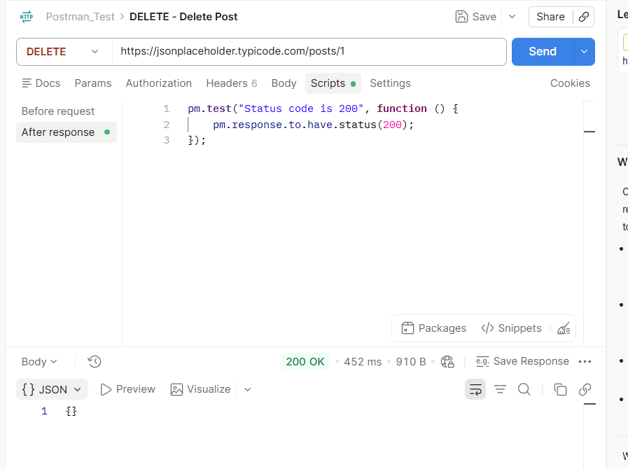
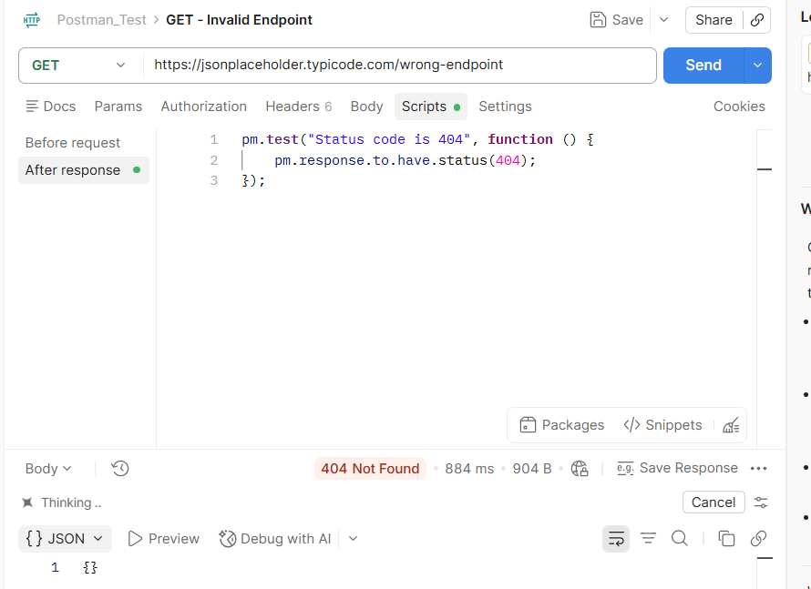

# BÁO CÁO KIỂM THỬ API BẰNG POSTMAN

## 1. Thông tin sinh viên

- Họ và tên: Cao Thanh Thảo
- Mã sinh viên: 23010168
- Lớp: LT2
- Môn học: Đánh giá và kiểm định chất lượng phần mềm

---

## 2. Mục tiêu

Sử dụng công cụ Postman để thực hiện kiểm thử API REST trên hệ thống JSONPlaceholder với các thao tác CRUD cơ bản.

Các nội dung thực hiện:

- Làm quen với công cụ Postman.
- Tạo collection và các request.
- Thực hiện các phương thức GET, POST, PUT, DELETE.
- Kiểm tra status code và response body.
- Viết test script cho từng API.
- Ghi nhận hình ảnh minh họa và tổng hợp kết quả kiểm thử.

---

## 3. Công cụ và môi trường

| Thành phần           | Thông tin                                   |
| -------------------- | ------------------------------------------- |
| Công cụ kiểm thử     | Postman                                     |
| API kiểm thử         | https://jsonplaceholder.typicode.com        |
| Định dạng dữ liệu    | JSON                                        |
| Phương thức kiểm thử | GET, POST, PUT, DELETE                      |
| Mục tiêu             | Kiểm tra chức năng và xác thực phản hồi API |

---

## 4. Danh sách API kiểm thử

| STT | Test Case                       | Method | Endpoint          | Kết quả mong đợi |
| --- | ------------------------------- | ------ | ----------------- | ---------------- |
| 1   | Lấy tất cả bài viết             | GET    | `/posts`          | 200 OK           |
| 2   | Lấy bài viết theo ID            | GET    | `/posts/1`        | 200 OK           |
| 3   | Tạo bài viết mới                | POST   | `/posts`          | 201 Created      |
| 4   | Cập nhật bài viết               | PUT    | `/posts/1`        | 200 OK           |
| 5   | Xóa bài viết                    | DELETE | `/posts/1`        | 200 OK           |
| 6   | Kiểm tra endpoint không tồn tại | GET    | `/wrong-endpoint` | 404 Not Found    |

---

## 5. Chi tiết kiểm thử

### 5.1. GET - Lấy tất cả bài viết

#### Request

```http
GET https://jsonplaceholder.typicode.com/posts
```

#### Mục đích

Kiểm tra API có trả về danh sách bài viết hay không.

#### Kết quả mong đợi

- Status code: 200 OK
- Response trả về dạng JSON array
- Dữ liệu có ít nhất 1 phần tử

#### Test Script

```javascript
pm.test("Status code is 200", function () {
  pm.response.to.have.status(200);
});

pm.test("Response is an array", function () {
  const data = pm.response.json();
  pm.expect(data).to.be.an("array");
});

pm.test("Response has posts", function () {
  const data = pm.response.json();
  pm.expect(data.length).to.be.above(0);
});
```

#### Kết quả thực tế

Các kiểm thử đều PASS.

#### Hình ảnh minh họa



---

### 5.2. GET - Lấy bài viết theo ID

#### Request

```http
GET https://jsonplaceholder.typicode.com/posts/1
```

#### Mục đích

Kiểm tra khả năng lấy chi tiết một bài viết dựa trên ID.

#### Kết quả mong đợi

- Status code: 200 OK
- `id` bằng 1
- Response bao gồm các trường: `userId`, `id`, `title`, `body`

#### Test Script

```javascript
pm.test("Status code is 200", function () {
  pm.response.to.have.status(200);
});

pm.test("Post ID is 1", function () {
  const data = pm.response.json();
  pm.expect(data.id).to.eql(1);
});

pm.test("Post has required fields", function () {
  const data = pm.response.json();
  pm.expect(data).to.have.property("userId");
  pm.expect(data).to.have.property("id");
  pm.expect(data).to.have.property("title");
  pm.expect(data).to.have.property("body");
});
```

#### Kết quả thực tế

Các kiểm thử đều PASS.

#### Hình ảnh minh họa



---

### 5.3. POST - Tạo bài viết mới

#### Request

```http
POST https://jsonplaceholder.typicode.com/posts
```

#### Request Body

```json
{
  "title": "Test Postman",
  "body": "This post was created using Postman",
  "userId": 1
}
```

#### Mục đích

Kiểm tra API có thể nhận dữ liệu đầu vào và tạo mới một bài viết thành công.

#### Kết quả mong đợi

- Status code: 201 Created
- Response có trường `id`
- `title` trả về đúng như dữ liệu đã gửi

#### Test Script

```javascript
pm.test("Status code is 201", function () {
  pm.response.to.have.status(201);
});

pm.test("Response has ID", function () {
  const data = pm.response.json();
  pm.expect(data).to.have.property("id");
});

pm.test("Title is correct", function () {
  const data = pm.response.json();
  pm.expect(data.title).to.eql("Test Postman");
});
```

#### Kết quả thực tế

Các kiểm thử đều PASS.

#### Hình ảnh minh họa



---

### 5.4. PUT - Cập nhật bài viết

#### Request

```http
PUT https://jsonplaceholder.typicode.com/posts/1
```

#### Request Body

```json
{
  "id": 1,
  "title": "Updated Postman",
  "body": "This post has been updated",
  "userId": 1
}
```

#### Mục đích

Kiểm tra khả năng cập nhật thông tin của một bài viết đã tồn tại.

#### Kết quả mong đợi

- Status code: 200 OK
- `id` bằng 1
- `title` được cập nhật thành "Updated Postman"

#### Test Script

```javascript
pm.test("Status code is 200", function () {
  pm.response.to.have.status(200);
});

pm.test("Post ID is 1", function () {
  const data = pm.response.json();
  pm.expect(data.id).to.eql(1);
});

pm.test("Title was updated", function () {
  const data = pm.response.json();
  pm.expect(data.title).to.eql("Updated Postman");
});
```

#### Kết quả thực tế

Các kiểm thử đều PASS.

#### Hình ảnh minh họa



---

### 5.5. DELETE - Xóa bài viết

#### Request

```http
DELETE https://jsonplaceholder.typicode.com/posts/1
```

#### Mục đích

Kiểm tra API có thực hiện thao tác xóa bài viết thành công hay không.

#### Kết quả mong đợi

- Status code: 200 OK
- Response trả về object rỗng hoặc xác nhận xóa thành công

#### Test Script

```javascript
pm.test("Status code is 200", function () {
  pm.response.to.have.status(200);
});
```

#### Kết quả thực tế

Kiểm thử PASS.

#### Hình ảnh minh họa



---

### 5.6. GET - Kiểm tra endpoint không tồn tại

#### Request

```http
GET https://jsonplaceholder.typicode.com/wrong-endpoint
```

#### Mục đích

Kiểm tra API phản hồi xử lý lỗi khi truy cập endpoint không tồn tại.

#### Kết quả mong đợi

- Status code: 404 Not Found

#### Test Script

```javascript
pm.test("Status code is 404", function () {
  pm.response.to.have.status(404);
});
```

#### Kết quả thực tế

Kiểm thử PASS.

#### Hình ảnh minh họa



---

## 6. Tổng hợp kết quả kiểm thử

| STT | Test Case              | Method | Expected | Actual | Status |
| --- | ---------------------- | ------ | -------- | ------ | ------ |
| 1   | Lấy tất cả bài viết    | GET    | 200      | 200    | PASS   |
| 2   | Lấy bài viết theo ID   | GET    | 200      | 200    | PASS   |
| 3   | Tạo bài viết mới       | POST   | 201      | 201    | PASS   |
| 4   | Cập nhật bài viết      | PUT    | 200      | 200    | PASS   |
| 5   | Xóa bài viết           | DELETE | 200      | 200    | PASS   |
| 6   | Endpoint không tồn tại | GET    | 404      | 404    | PASS   |

---

## 7. Kết luận

Qua bài thực hành, em đã làm quen với công cụ Postman và thực hiện kiểm thử API REST trên JSONPlaceholder. Các thao tác quan trọng như GET, POST, PUT và DELETE đã được thực hiện thành công, đồng thời các kiểm tra status code và response body cũng đạt kết quả mong đợi.

Những nội dung đã thực hiện bao gồm:

- Tạo collection trên Postman.
- Thực hiện các request GET, POST, PUT, DELETE.
- Kiểm tra status code và dữ liệu response.
- Viết test script cho từng trường hợp.
- Lưu collection và chụp ảnh minh họa kết quả.
- Đưa báo cáo và sản phẩm lên GitHub.

---

## 8. Tài liệu tham khảo

- Video hướng dẫn Postman: https://www.youtube.com/watch?v=MFxk5BZulVU
- JSONPlaceholder: https://jsonplaceholder.typicode.com/
- Postman Documentation: https://learning.postman.com/
